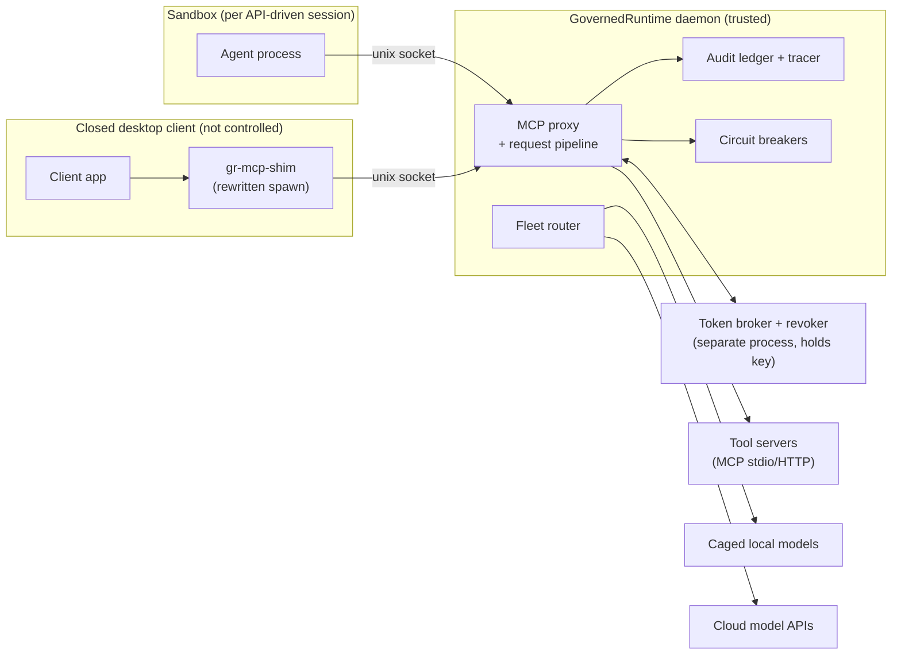
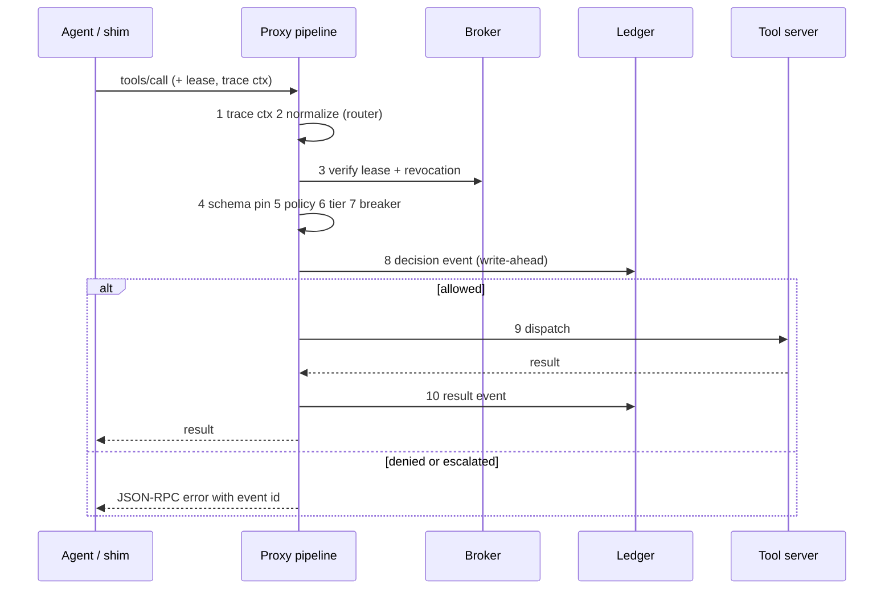

# GovernedRuntime Architecture
**File:** /docs/architecture.md
**Description:** Target architecture after post 24, the contracts every module shares, and the incremental build state after each post.
**Author:** Libor Ballaty
**Created:** 2026-11-18

Status: Draft design. Nothing in this document is built yet. Every statement here is reasoned design, not
measured behaviour. As modules ship, each section gets a "Built at" note naming the tag and what was run.

Companion documents: `docs/content-plan.md` (posts, platforms, schedule) and `README.md` (status language
and per-post requirements).

## 1. Scope

GovernedRuntime is a local control plane that sits between AI agents and the resources they act on. It
treats every agent action as a privileged system event: identified, authorized, recorded, and attributable
to a run, before it executes.

In scope at v1.0 (after post 24):
- One host (macOS first, Linux as an open decision), many agent sessions, several model providers.
- Two session classes: agents we launch (API-driven) and closed desktop clients we do not control
  (subscription-driven).
- Tool access over MCP (stdio and HTTP) and provider-native tool calls normalized by the router.

Out of scope at v1.0 (see section 8): multi-host fleets, detecting prompt injection by content, governing a
closed client's built-in tools, high availability, Windows.

## 2. Design principles

| # | Principle | Consequence |
|---|---|---|
| P1 | Control lives outside the model | No security property depends on a prompt. Prompts can only make an agent ask for less. |
| P2 | Fail closed | If the broker, ledger, policy or schema check cannot answer, the action is denied. |
| P3 | Record before act | The decision event is written to the ledger before the action is dispatched. A ledger write failure is a deny. |
| P4 | One identity per run | Every event carries `trace_id`, `session_id` and, from post 7, `lease_id`. Nothing is anonymous. |
| P5 | Secrets never enter the sandbox | The lease signing key, provider API keys and the ledger's write handle live in the daemon or broker process. |
| P6 | Least privilege by default, raised explicitly | Sessions start with the class profile from the classifier. More scope needs a lease; more risk needs a tier. |
| P7 | Every module emits | From post 2 on, a module is incomplete until its decisions reach the ledger and its tests assert that. |

## 3. Target architecture (after post 24)

### 3.1 Components and trust boundaries



Trust boundaries, from least to most trusted:
1. **Agent process**: untrusted. Confined by the OS profile: no outbound network, writes only to its
   workspace, may connect only to the daemon's unix socket and the caged model's loopback port.
2. **Closed client**: untrusted and uncontrolled. We govern only the tool servers its config launches.
3. **Tool servers**: semi-trusted. Their schemas are pinned, and they can only be reached through the proxy.
4. **Daemon**: trusted. Runs as the user, outside any sandbox.
5. **Broker**: most trusted. A separate process so the signing key is not in the daemon's address space
   either.

Control plane transport is a unix domain socket with file-permission access control, not a TCP port. This
avoids the port-allocation question for local traffic and makes "who can connect" an OS question. An HTTP
listener for remote MCP servers is optional and loopback-only.

### 3.2 The request pipeline (one tool call)



Stage order is fixed. A stage that cannot decide returns deny (P2). Stage 8 happens before stage 9 for every
call, including denials, so the ledger also holds what was attempted (P3).

| Stage | Module (post) | Denies when |
|---|---|---|
| 1 Trace context | `tracer.py` (3) | Never; creates a context if missing and records that it did |
| 2 Normalize | `fleet_router.py` (14) | Call cannot be mapped to a known scope |
| 3 Lease | `token_broker.py` (7), `lease_revoker.py` (8) | Bad signature, expired, revoked, scope mismatch |
| 4 Schema | `schema_validator.py` (12), `schema_pinning.py` (13) | Tool schema hash differs from the pinned hash |
| 5 Policy | `policy_evaluator.py` (15) | Arguments violate a rule |
| 6 Tier | `action_matrix.py` (16) | Tier 3 and the human declines or the gate times out |
| 7 Breaker | `circuit_breaker.py` (17) | Session or tool breaker is open |
| 8 to 10 Record | `audit_sink.py` (2) | Ledger write fails |

### 3.3 Session lifecycle

1. **Classify** (post 4). The classifier inspects launch path and parent process and assigns a class:
   `api_daemon`, `subscription_harness`, or `unknown`. `unknown` gets the most restrictive profile.
2. **Contain** (posts 1, 6). `api_daemon` sessions start under the sandbox profile. Harness sessions cannot
   be sandboxed by us; their tool servers are reached through the shim (post 11).
3. **Identify** (posts 3, 7). The daemon opens a trace and asks the broker for an initial lease with the
   class's default scopes.
4. **Act** (posts 10 to 17). Every tool call goes through the pipeline in 3.2.
5. **Contain failure** (posts 8, 17). A tripped breaker revokes the session's leases through the revoker.
6. **Close**. Leases are revoked, the trace is closed, and a session summary event is written.

## 4. Shared contracts

These are defined once and used by every module. Changing one is a versioned change to all emitters.

### 4.1 Audit event (post 2)

One JSON object per line in an append-only file.

| Field | Type | Notes |
|---|---|---|
| `seq` | int | Monotonic per ledger |
| `ts` | RFC 3339 UTC | |
| `event_type` | string | e.g. `sandbox.denied`, `lease.minted`, `tool.decision`, `tool.result` |
| `component` | string | Emitting module |
| `trace_id`, `span_id`, `parent_span_id` | string | From the tracer (post 3); null only for events before post 3 ships |
| `session_id`, `session_class` | string | From the classifier (post 4) |
| `lease_id` | string or null | From post 7 |
| `subject` | object | Tool, server, resource path or model, depending on type |
| `decision` | enum | `allow`, `deny`, `escalate`, `error`, `info` |
| `reasons` | list | Rule ids, check names, error codes |
| `schema_hash`, `policy_version`, `tier` | string or null | Filled as those stages exist |
| `prev_hash`, `hash` | hex | SHA-256 chain over the canonical JSON of the event without `hash` |

Arguments and results are stored as hashes by default, with a configurable allow-list for fields that may be
stored in clear. This keeps personal data out of a log that cannot be edited.

Known limit (flagged in the plan): a hash chain detects edits to past entries. It does not detect truncation
or wholesale rewrite by someone with write access unless the chain head is anchored where they cannot write.
The anchor is an open decision (section 9).

### 4.2 Trace context (post 3)

W3C Trace Context format (`traceparent`). Propagated to the sandboxed agent as an environment variable at
launch, and through MCP in the JSON-RPC `_meta` field. The proxy creates a context when a client does not
send one and records that it did.

### 4.3 Capability lease (post 7)

| Field | Notes |
|---|---|
| `lease_id` | Random, unique |
| `session_id` | Bound to one session |
| `scopes` | e.g. `workspace:write`, `db:read`, `tool:<server>/<name>` |
| `iat`, `exp` | TTL 5 to 15 minutes, configurable per scope |
| `nonce` | Prevents replay across sessions |
| `sig` | HMAC-SHA256 by the broker |

Verification is done by the broker (or by the daemon holding a verify-only derived key; decided at post 7).
Revocation (post 8) is a registry keyed by `lease_id` and `session_id`, checked on every verification.

### 4.4 Canonical tool call (post 14, used from post 10)

`{provider, server_id, tool_name, arguments, schema_hash, lease, traceparent}`. Post 10 introduces it for
MCP. Post 14 adds adapters that map provider-native tool-call formats onto it.

### 4.5 Policy decision (post 15) and tier (post 16)

Policy returns `{decision, rule_ids, policy_version}`. The action matrix returns `{tier: 1|2|3, reason}`.
Tier 1 runs. Tier 2 runs and is flagged for asynchronous review in the ledger. Tier 3 waits for a human
through a local approval command, and times out to deny.

## 5. Incremental build

Each row is the state of the system after that post. "Proves it" is the test that must pass before the
post's tag is cut. All rows from post 2 on also require ledger events and trace ids asserted in tests (P7).

### 5.1 Month 1: contain, record and identify

| Post | Adds | Wires into | System can now | Proves it |
|---|---|---|---|---|
| 1 | Sandbox runner + OS profile | (nothing yet) | Run an agent with no outbound network and one writable workspace | Network connect and write outside workspace both fail |
| 2 | Audit ledger | Sandbox runner emits launch, exit and denials | Show a tamper-evident record of what each sandboxed run attempted | Editing any past line breaks chain verification |
| 3 | Tracer | Runner and ledger | Read one run back as an ordered trace | All events of a run share one `trace_id` |
| 4 | Session classifier | Runner chooses profile by class; class on every event | Start each session with a class-appropriate boundary | `unknown` class gets the strictest profile |
| 5 | Cost benchmark | Writes a placement table (local vs cloud per workload) | Decide model placement from measured numbers | Benchmark is reproducible on a stated machine |
| 6 | Local model cage | Sandbox profile allows only the caged model's loopback port | Run local models without exposing the host | Model server not reachable off loopback and cannot read outside its directory |
| 7 | Token broker | Runner requests an initial lease; lease id on every event | Give agents short-lived, scoped credentials with no standing secrets | Expired, tampered and out-of-scope leases all rejected |
| 8 | Lease revoker | Broker checks registry on every verify | Cut an agent off immediately | A revoked lease fails on the next call, with no restart |
| 9 | `daemon.py` phase 1 | All of the above under one start command | Start a classified, sandboxed, traced, leased session in one step | End-to-end launch test produces a verified chain |

After post 9 the system contains and records agents but does not yet see their tool calls.

### 5.2 Month 2: gateway and policy

| Post | Adds | Wires into | System can now | Proves it |
|---|---|---|---|---|
| 10 | MCP proxy + `gr-mcp-shim` | Pipeline stages 1, 3, 8 to 10 | Authorize and record every MCP tool call from a sandboxed agent | Call without a valid lease is denied and recorded |
| 11 | Config interceptor | Rewrites client configs to launch servers via the shim; backup and restore | Govern the tool servers a closed client launches | Rewritten config round-trips; restore returns the original byte for byte |
| 12 | Schema validator | Pipeline stage 4, in-session baseline | Reject calls to a tool whose definition changed since approval | Changed description causes deny |
| 13 | Schema pinning | Persistent manifest, verified at startup | Keep approvals across restarts; require explicit re-approval on change | Restart with a modified server fails closed |
| 14 | Fleet router | Pipeline stage 2; uses placement table from post 5 | Apply one set of controls across providers and local models | Same logical call from two providers yields the same scope and decision |
| 15 | Policy evaluator | Pipeline stage 5 | Block calls by their arguments, not just by tool | Rule violation denied; rule id in the event |
| 16 | Action matrix | Pipeline stage 6 + approval command | Route actions to run, run-and-review, or human gate | Tier 3 call waits, and times out to deny |
| 17 | Circuit breaker | Pipeline stage 7; trips revoke leases via post 8 | Stop a failing agent before it spreads damage | Threshold breach opens breaker and revokes the session's leases |
| 18 | `daemon.py` phase 2 | Proxy, interceptor, pins, router, policy, tiers, breakers in the daemon | Run the full pipeline for both session classes | End-to-end test covers both classes and all eight stages |

After post 18 every governed action is decided by the full pipeline and recorded.

### 5.3 Month 3: evidence and scale

| Post | Adds | Wires into | System can now | Proves it |
|---|---|---|---|---|
| 19 | Policy mapper | Reads ledger; maps event types and rule ids to clause ids | Show which regulatory obligations each recorded control supports | Every mapped clause cites at least one event type |
| 20 | Auditor report generator | Reads ledger, mapper and chain verification | Produce a report an auditor can check against the ledger | Each statement in the report links to event ranges and a verified chain head |
| 21 | Tenant isolation reference | Adds `tenant_id` to the session and event contracts; SQL RLS checks for a backend | Keep a multi-tenant backend's data separated per tenant | Cross-tenant query returns no rows under test |
| 22 | Benchmark suite | Measures per-stage latency of the pipeline | State the overhead of each control with numbers | Results published with hardware and method |
| 23 | Production manifest | One declarative config for every module | Configure a deployment from one file | Manifest validates against a schema; daemon boots from it |
| 24 | `daemon.py` v1.0 | Manifest-driven boot, lifecycle and shutdown | Run the whole stack as one service | Full suite passes on the stated platform |

## 6. Status after post 24 (v1.0)

What v1.0 is:
- A single-host daemon that sandboxes agents it launches and governs the tool servers of clients it cannot
  sandbox.
- Every tool call passes eight ordered stages and is recorded before and after execution in a hash-chained
  ledger, with trace, session, lease, schema, policy and tier context.
- Credentials are short-lived, scoped and revocable. No standing secret enters an agent.
- Evidence maps to regulatory clauses and can be reported to auditors from the ledger alone.
- Overhead is measured per stage.

What v1.0 is not (stated in post 24):
- Not a multi-host fleet manager. "Fleet" means many sessions and providers on one host.
- Not a prompt-injection detector. It limits what an injected agent can do; it does not judge content.
- Not a governor of a closed client's built-in tools, only of the MCP servers its config launches.
- Not highly available. If the daemon stops, governed actions stop (fail closed).
- Not certified against any regulation. It produces evidence; conformity is the organization's assessment.

## 7. Repository layout at v1.0

```
daemon.py
modules/
  00_audit/       audit_sink.py, tracer.py
  01_sandbox/     sandbox_runner.py, strict_agent.sbpl, session_classifier.py, cost_benchmark.py,
                  local_slm_cage.sh, token_broker.py, lease_revoker.py
  02_gateway/     mcp_proxy.py, gr_mcp_shim.py, mcp_config_interceptor.py, schema_validator.py,
                  schema_pinning.py, fleet_router.py, circuit_breaker.py
  03_compliance/  policy_evaluator.py, action_matrix.py, policy_mapper.py, auditor_report_gen.py,
                  tenant_isolation_check.sql, benchmark_suite.py
contracts/        JSON schemas for event, lease, canonical call, decision, manifest
examples/         production_manifest.yaml, demos per post
tests/            per module, plus end-to-end at tags phase-1, phase-2, v1.0
docs/             architecture.md, content-plan.md
```

New relative to the content plan: `gr_mcp_shim.py` (needed by posts 10 and 11 to route stdio servers through
the proxy) and `contracts/` (so the shared contracts in section 4 are machine-checked).

## 8. Gaps and candidate follow-on work

| Gap | Why it matters | Candidate |
|---|---|---|
| Ledger anchoring | Without it, truncation or full rewrite is undetectable | Periodic signed head to an external write-once store |
| Linux sandbox | macOS-only limits the audience and CI | bubblewrap or Landlock profile behind the same runner interface |
| Multi-host | Fleets across machines | Remote nodes forwarding events to a central ledger |
| Content inspection | Injection still steers the agent within its allowed scope | Optional classifier stage, advisory only, never the sole control |
| Daemon availability | Fail closed means an outage stops work | Supervisor and restart with ledger continuity checks |

## 9. Open design decisions

| Decision | Needed by | Options |
|---|---|---|
| Ledger chain anchor | Post 2 | Local signed checkpoints only, or an external store |
| Lease verification location | Post 7 | Broker verifies every call, or daemon holds a verify-only key |
| Linux support at v1.0 | Post 1 | macOS only, or both from the start |
| Approval channel for tier 3 | Post 16 | CLI command, local web page, or desktop notification |
| Argument storage in the ledger | Post 2 | Hash only by default (proposed), or clear text with redaction |

## 10. Gap review

- Every post in `docs/content-plan.md` appears in section 5 with its module. Checked against the plan on
  2026-11-18.
- Two components are added here that the plan does not list: `gr_mcp_shim.py` and `contracts/`. The plan
  should reference them.
- Post 21 adds `tenant_id` to shared contracts late. If multi-tenancy is a v1.0 requirement, the field should
  exist (nullable) from post 2 so the ledger format does not change.
- Nothing in this document has been built or run.
